# UIClip / CLIP / SigLIP investigation

Track 4 of the [model investigation plan](model-investigation-plan.md).

## Model

UIClip (Wu et al., UIST 2024, [arXiv 2404.12500](https://huggingface.co/papers/2404.12500)) is OpenAI CLIP ViT-B/32 fine-tuned on JitterWeb (synthetic web pages with injected design defects) to score UI design quality. Only weights are public, on [Hugging Face (BIG Lab, MIT licence)](https://huggingface.co/biglab); there is no official training repo. Checkpoints load as standard `CLIPModel` weights and use the `openai/clip-vit-base-patch32` preprocessing:

- `biglab/uiclip_jitteredwebsites-2-224-paraphrased`
- `biglab/uiclip_jitteredwebsites-2-224-paraphrased_webpairs`
- `biglab/uiclip_jitteredwebsites-2-224-paraphrased_webpairs_humanpairs` (default)

UIClip scores whole screenshots, so on its own it cannot localize a change, and resizing a 1280 px page to 224 px removes 1–2 px changes. We therefore:

1. resize both screenshots to a whole number of tiles across (1344 px = 6 × 224) with the same scale factor;
2. cut them into aligned 224 × 224 tiles;
3. use the encoder's 7 × 7 patch tokens per tile, fused as `[a, b, |a−b|, a·b]`;
4. predict a per-patch change map, an image-level regression score, and the mutation operator.

```text
ref tiles  ──┐                           ┌─> patch logits ─> change map (localization)
             ├─ UIClip vision (shared) ──┤─> image logit (regression vs not)
cand tiles ──┘   patch tokens [T,49,768] └─> type logits (13 operators)
```

## Main findings

**Setup of these results:**
- **Runs:** two batches, all trained for 10 epochs.
  - The first, from `scripts/run_uiclip_experiments.sh`: UIClip and CLIP variants.
  - The follow-up, from `scripts/run_clip_siglip_experiments.sh`: CLIP fine-tuned, and SigLIP-512 frozen and fine-tuned.
- **Seeds:** every experiment has seeds 0, 1 and 2, except SigLIP fine-tuned, which has one seed. Each run is represented by its best-AUROC checkpoint, and values are means across seeds (± standard deviation where shown).
- **Evaluation:** on the validation split: 73 pages, 1,108 pairs (889 regression, 146 benign, 73 no-change).
- **Where the data is:**
  - Scoring used `scripts/score_predictions.py`, and the full table is in [`comparison.md`](../results/uiclip/comparison.md).
  - Every run's metrics, configuration and the best models' predictions are in [`docs/results/uiclip/`](../results/uiclip/README.md).
- [Figures](#figures) below illustrate these findings.

| Experiment | AUROC reg/benign | Benign FPR @95% recall | F1 | Benign FPR | No-change FPR | Type macro-F1 | Pointing | Mean IoU | Recall, reflowed changes |
|---|---|---|---|---|---|---|---|---|---|
| UIClip, frozen (`uiclip_cal`) | 0.9927 ± 0.0019 | 0.009 | 0.983 | 0.041 | 0.032 | 0.36 ± 0.03 | 0.44 | 0.20 | 0.82 |
| UIClip, frozen, no calibration (`uiclip_nocal`) | 0.9945 ± 0.0006 | 0.002 | 0.983 | 0.030 | 0.055 | 0.35 ± 0.03 | 0.47 | 0.21 | 0.81 |
| CLIP, frozen (`clip_cal`) | 0.9924 ± 0.0019 | 0.009 | 0.979 | 0.039 | 0.027 | 0.34 ± 0.06 | 0.40 | 0.21 | 0.78 |
| SigLIP-512, frozen (`siglip_cal`) | 0.9982 ± 0.0004 | 0.007 | 0.975 | 0.011 | 0.037 | 0.36 ± 0.02 | 0.50 | 0.21 | 0.84 |
| UIClip, no benign training pairs (`uiclip_cal_nobenign`) | 0.6224 ± 0.0569 | 0.993 | 0.919 | 1.000 | 0.041 | 0.38 ± 0.01 | 0.46 | 0.18 | 1.00 |
| UIClip, last 4 blocks fine-tuned (`uiclip_cal_ft4`) | 0.9988 ± 0.0007 | 0.009 | 0.995 | 0.034 | 0.041 | 0.45 ± 0.00 | 0.47 | 0.19 | 1.00 |
| CLIP, last 4 blocks fine-tuned (`clip_cal_ft4`) | 0.9996 ± 0.0001 | 0.000 | 0.995 | 0.014 | 0.041 | 0.40 ± 0.08 | 0.48 | 0.19 | 0.98 |
| SigLIP-512, last 4 blocks fine-tuned (1 seed) (`siglip_cal_ft4`) | 0.9999 | 0.000 | 0.993 | 0.000 | 0.041 | 0.44 | 0.57 | 0.16 | 0.95 |

1. **Fine-tuning the last 4 encoder blocks matters more than which backbone you start from.**
   - All three fine-tuned models reach AUROC ≥ 0.998, F1 0.993–0.995, and recall of 0.95–1.00 on reflowed changes (0.78–0.84 frozen).
   - Fine-tuning raises F1 by up to 0.018 (from 0.975 for SigLIP and 0.979 for CLIP). Switching backbones moves it by at most 0.008.
   - Type macro-F1 also improves under fine-tuning: from 0.36 to 0.45 for UIClip, from 0.34 to 0.40 for CLIP, and from 0.36 to 0.44 for SigLIP.

2. **Benign training pairs are essential.**
   - Trained only on regressions and identical pairs, the model flags every Firefox/WebKit pair (benign FPR 1.00, AUROC 0.62), while still catching 99% of regressions.
   - In effect it learns "any difference is a regression".
   - The benign pairs were removed from training only. The model is still scored on the same 146 validation benign pairs as every other experiment.
   - This is the clearest answer to the regression-only vs. regression + benign question in the [investigation plan](model-investigation-plan.md).

3. **UI-specific pretraining makes little difference once the encoder is fine-tuned.**
   - **Frozen:** UIClip is slightly ahead of plain CLIP: F1 0.983 vs 0.979, pointing 0.44 vs 0.40, and reflow recall 0.82 vs 0.78.
   - **Fine-tuned:** CLIP matches or beats UIClip on detection: AUROC 0.9996 vs 0.9988, benign FPR 0.014 vs 0.034, and pointing 0.48 vs 0.47.
   - **What UIClip keeps:** more stable type classification (macro-F1 0.45 ± 0.004 vs 0.40 ± 0.08) and recall of every reflowed change (1.00 vs 0.98).
   - This answers the track's research question: on this task, UI-aware pretraining gives at most a small, inconsistent benefit, and fine-tuning a general model on our data matters far more.

4. **Finer patches (SigLIP-512) help find where a change is, but not draw its box.**
   - SigLIP's change map has cells of about 13 px, against about 30 px for UIClip/CLIP.
   - **Pointing:** 0.50 frozen, against 0.40–0.44 for frozen UIClip/CLIP. Fine-tuned it reaches 0.57, the best of any model, on one seed.
   - **False alarms:** frozen SigLIP also has the fewest of the frozen models: benign FPR 0.011, against about 0.04.
   - **Boxes:** mean IoU stays at 0.16–0.21 across every experiment. Fine-tuned SigLIP has the *lowest* IoU, 0.16.
   - So box quality is limited by how boxes are produced, not by encoder resolution. Boxes are drawn around the largest change-map region above 0.5, and the `diff_bbox` target of a reflowed change covers everything that moved.
   - **Cost:** about 4× the training time of UIClip/CLIP, even with the feature cache (see [Training cost](#training-cost)).

5. **Self-calibration fixes the identical-pair problem without hurting detection.**
   - No-change FPR falls from 0.055 to 0.032, while AUROC (0.993 vs 0.995) and F1 (0.983 for both) are essentially unchanged.
   - The remaining no-change false positives are mostly pairs that aren't actually identical (see below).
   - Pointing accuracy is lower with calibration (0.44 vs 0.47). Whether that's a real cost is still open.

6. **Detection is saturated on this validation set; localization and change type are the open problems.**
   - **Detection:**
     - The fine-tuned models score AUROC ≥ 0.998 and benign FPR at 95% recall of 0–0.009. The remaining gaps are a pair or two, too small to rank them.
     - Recall is about the same for small, medium and large mutations.
   - **Change type, for the best UIClip model:** see the [confusion matrices](#figures).
     - The exact type is right 44% of the time, but the right *family* (colour, appearance, shape, typography, layout) 67% of the time.
     - Errors are mostly between similar-looking changes. Opacity is predicted as text colour 53% of the time; font size, letter spacing and font weight are confused with each other; and layout changes (margin, padding, position, width) are often predicted as padding or font size.
     - Margin is almost never predicted correctly.
     - **The fine-tuned CLIP and SigLIP models show the same pattern:** exact type 40% and 43%, right family 62% and 68% (SigLIP on one seed).
     - Each backbone falls back on its own "default guess" for uncertain changes: margin for CLIP, padding and width for SigLIP, padding and font size for UIClip.
   - **Per-type F1:** background-colour and border changes are recognised well (F1 0.66–0.91 across models). Spacing and typography types (font size, margin, position, padding, line height, letter spacing, font weight) stay at about 0.07–0.46 for every backbone.

7. **Best-AUROC checkpoint selection becomes arbitrary once AUROC saturates.**
   - The selected epochs ranged from 1 to 10. One frozen SigLIP seed picked epoch 1, before the type head had learned much, which partly explains frozen SigLIP's lower recall (0.957 ± 0.029).
   - Validation loss bottoms out around epochs 4–7 for every model, then rises, a sign of overfitting.
   - Choosing the checkpoint by validation loss, or training for about 6 epochs, would likely give steadier models.

8. **Seed variance is large relative to the differences between models.**
   - The same configuration's benign FPR ranges from 0.014 to 0.068 across seeds, and CLIP fine-tuned's type macro-F1 from 0.31 to 0.47.
   - Compare models by mean ± spread over several seeds, never by single runs. The one-seed SigLIP fine-tuned result is therefore tentative.

### Training cost

Wall-clock time per 10-epoch run on the [machine below](#machine-used-for-these-experiments), averaged over seeds and excluding runs that also built a cache:

| Setup | Time per run | Feature cache |
|---|---|---|
| UIClip or CLIP, frozen | ~10 min | ~49 GB, built once in ~5 min |
| UIClip or CLIP, last 4 blocks fine-tuned | ~37 min | ~49 GB (first 8 blocks), built once in ~5 min |
| SigLIP-512, frozen | ~38 min (vs ~2.3 h uncached) | ~266 GB, built once in ~10 min |
| SigLIP-512, last 4 blocks fine-tuned | ~3.4 h | none (a second ~266 GB cache would barely help) |

The first batch took 3 h 55 min and the follow-up 7 h 27 min. All caches together take about 460 GB.

**Caveats:**
- These are validation numbers: the best epoch and the threshold were both selected on validation, so they are optimistic.
- **All results above use the old placeholder split, not the team split** (`data/splits/splits_85_15.json`, now the default).
  - The two splits come from the same seeded shuffle, cut at opposite ends, so their validation sets share no pages.
  - Comparing with teammates' models needs a retrain on the team split; the feature caches are reused.
- There is no test split yet.
- Generalization to DiffSpot is untested.
- 25 of the dataset's 484 `no_change` pairs are not actually identical.
- SigLIP fine-tuned has a single seed.

**Next steps:**
- Evaluate the frozen best models on DiffSpot, and add a page-level test split. The validation set can no longer separate the fine-tuned models.
- Select checkpoints by validation loss, or train for about 6 epochs, instead of by best AUROC.
- Improve box extraction, e.g. by thresholding relative to the peak, by using `bbox_after` as the training target for reflowed changes, or by training mask-level targets.
- Consider predicting the change *family* (67% correct) alongside the exact type (44%), or reporting it for the VLM stage.
- Run 2 more SigLIP fine-tuned seeds if localization becomes the priority.
- Pass the change map, or its peak point, to the VLM description stage. Points are more reliable than our boxes.

### Figures

Generated by `scripts/plot_uiclip_findings.py` into two folders. Use `--only first_batch` or `--only all_experiments` to redraw just one.

**[`all_experiments/`](../figures/uiclip/all_experiments/)** covers both batches, all three backbones, frozen and fine-tuned. These are the current results.

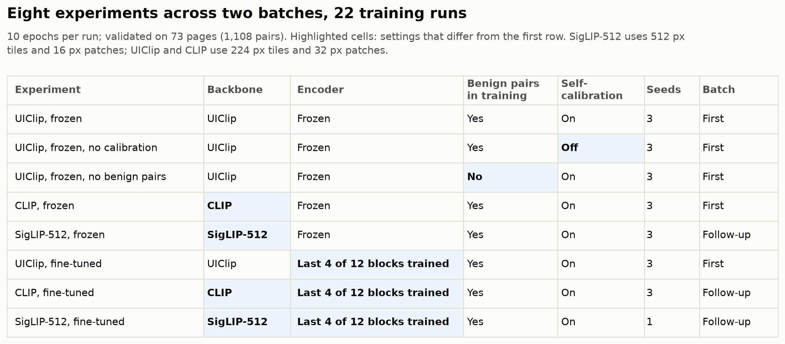

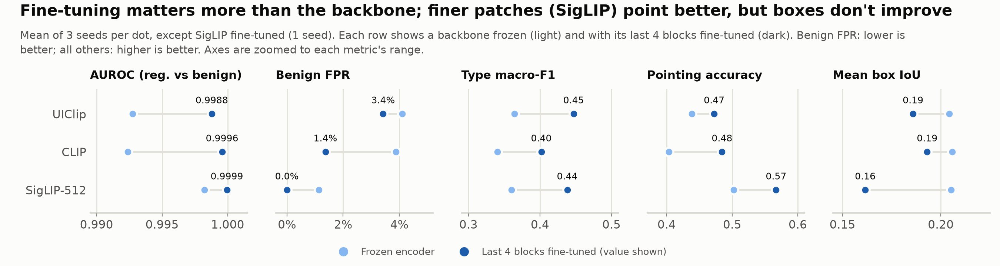

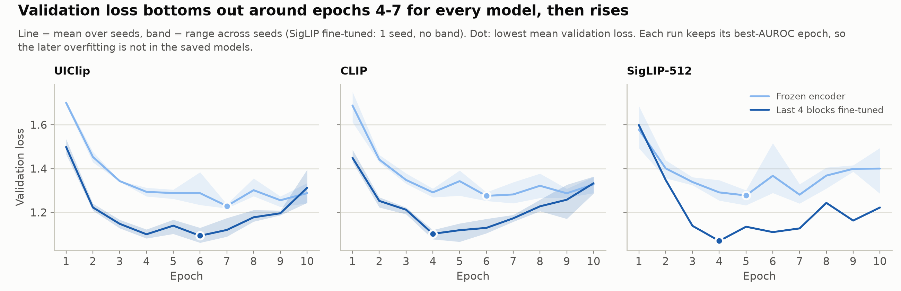

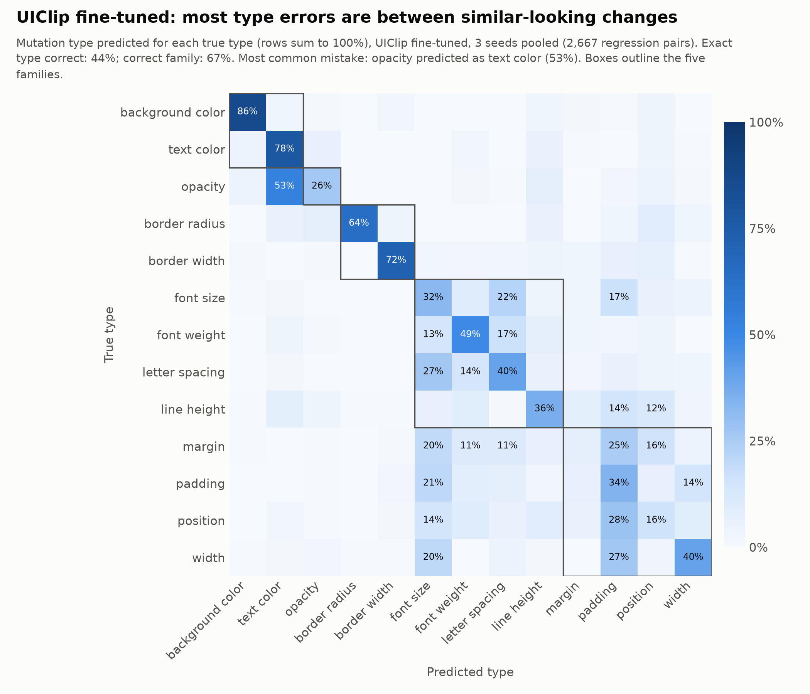

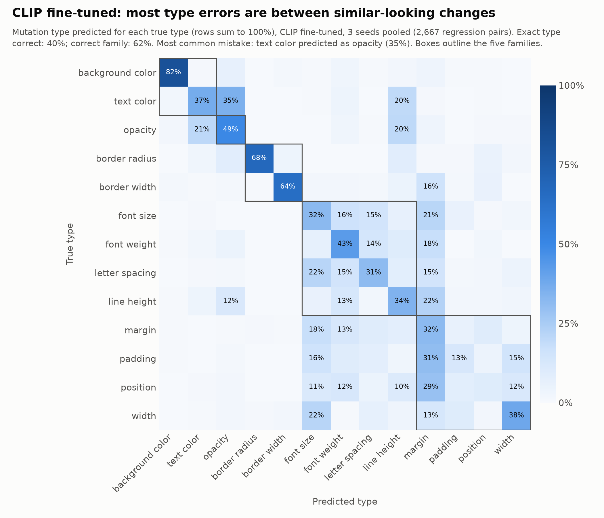

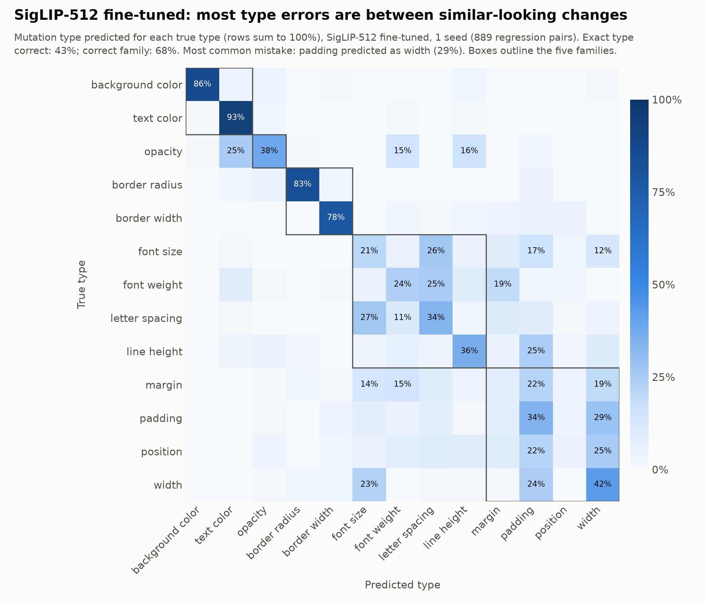

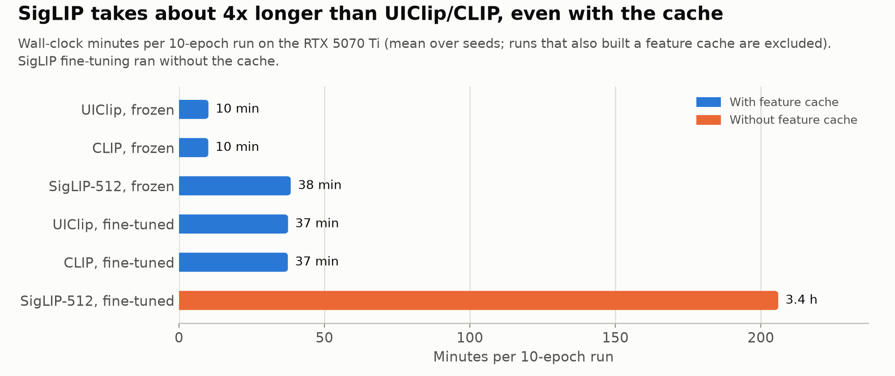

**[`first_batch/`](../figures/uiclip/first_batch/)** covers the first batch only: UIClip and CLIP, before CLIP fine-tuning and SigLIP were run.
- The benign-pairs and identical-pairs figures (2 and 4) are still current. No later experiment changed those comparisons, and every later calibrated run also gives all pixel-identical pairs a single score.
- Figure 3's "UIClip edges out CLIP" applies to the frozen encoders only; `all_experiments/2` shows the gap disappears after fine-tuning.

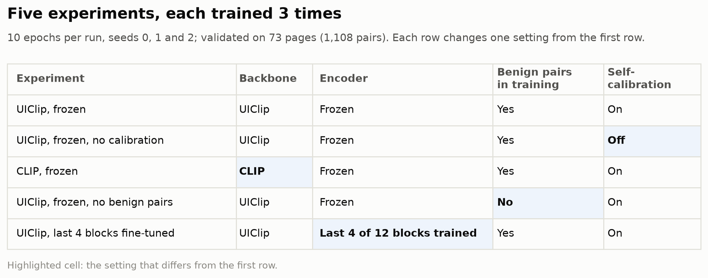

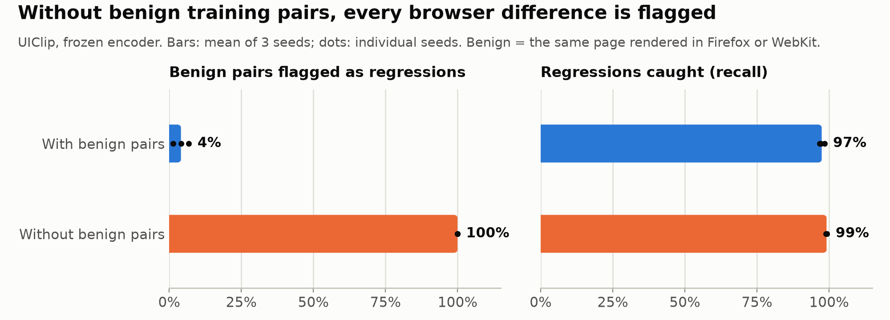

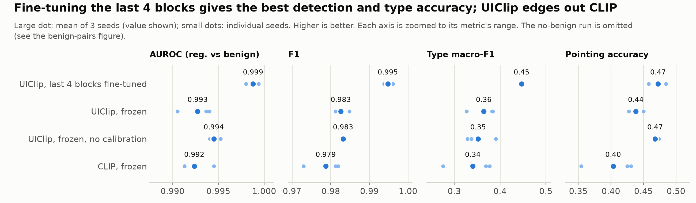

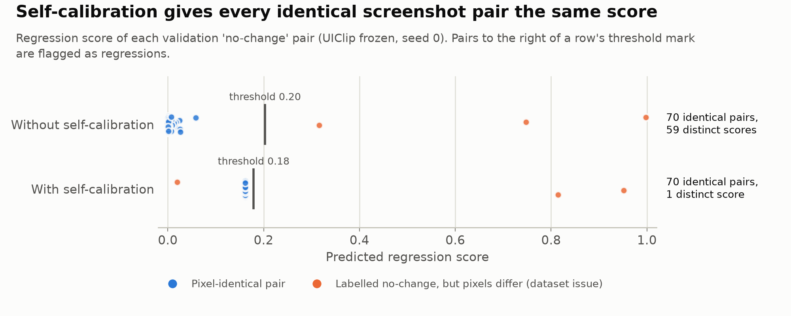

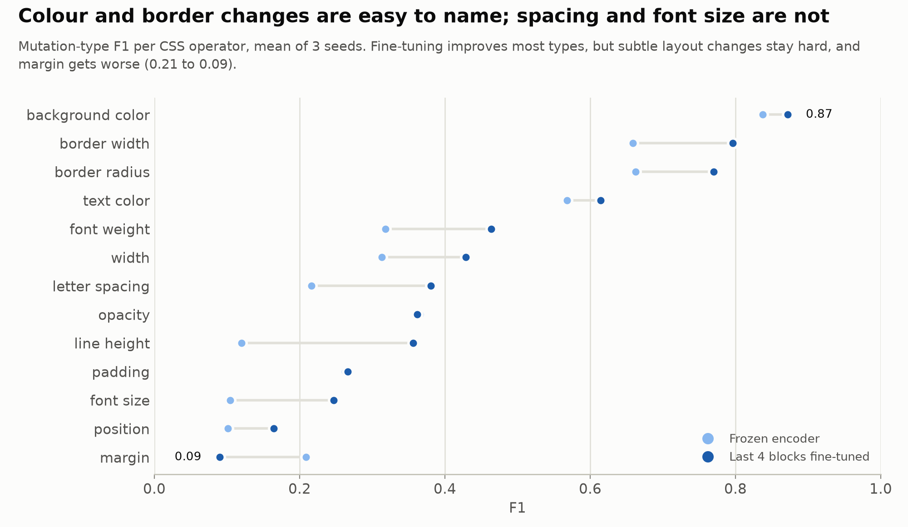

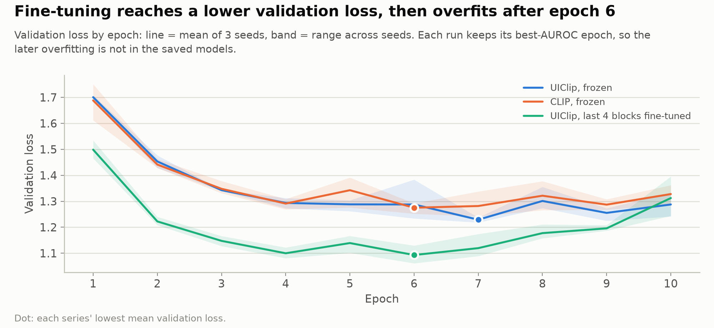

## Code

| Path | Contents |
|---|---|
| `src/regression_lens/data/splits.py` | loads and checks page-level splits; the team split is `data/splits/splits_85_15.json` (411/73 pages) |
| `src/regression_lens/data/pairs.py` | `PairDataset`: tiling, patch targets from `diff_bbox` |
| `src/regression_lens/data/feature_cache.py` | on-disk cache of frozen encoder features |
| `src/regression_lens/models/uiclip.py` | `SiameseDetector`, `detector_loss`, checkpoint ids |
| `src/regression_lens/evaluation/metrics.py` | precision/recall/F1, FPR, macro-F1, box IoU, pointing accuracy |
| `src/regression_lens/evaluation/scoring.py` | shared scoring of prediction files |
| `scripts/train_uiclip.py` | training and evaluation CLI, writes `outputs/<exp>/` |
| `scripts/score_predictions.py` | scores and compares any models' prediction files |

## Setup

You need Python 3.10 or newer. A GPU is optional: the training script uses an NVIDIA GPU (CUDA) if PyTorch can see one and falls back to the CPU otherwise. It doesn't use Apple's MPS backend, so Macs run on the CPU.

1. **Create and activate a virtual environment** in the project folder:

   ```bash
   python -m venv .venv
   source .venv/bin/activate          # Linux, macOS, WSL
   # .\.venv\Scripts\Activate.ps1     # Windows PowerShell
   ```

   On Debian/Ubuntu, `python -m venv` fails until the `python3-venv` package is installed (e.g. `sudo apt install python3.12-venv`).

2. **Install PyTorch for your hardware.** Use the selector at [pytorch.org/get-started](https://pytorch.org/get-started/locally/), which gives the right command for CPU-only, a CUDA version, or ROCm. Install it before the next step, otherwise pip picks a default build that may not match your GPU.

3. **Install the project and its model dependencies:**

   ```bash
   pip install -e ".[dev,uiclip]"
   python -m pytest                   # should pass without a GPU
   ```

4. **Get the data.** Unzip `d2c_v3.zip` so that `d2c_v2/master_dataset_with_benign.json` and `d2c_v2/screenshots/` exist in the project folder, or point `--data-root` at another location.

Practical notes:

- **Disk:** each feature cache takes about 53 GB for UIClip/CLIP (see [Feature caching](#feature-caching)), and the full experiment batch builds three of them. Training without `--cache-features` needs no extra disk.
- **CPU-only:** the pipeline works but is much slower. Use the feature cache, and check the setup first with a smoke run (`--limit-pages 5 --epochs 1`).
- **Shell:** `scripts/run_uiclip_experiments.sh` is a bash script. On Windows, run it from WSL or Git Bash, or run its `train_uiclip.py` commands one by one.
- **First run:** model weights download from Hugging Face on first use (about 600 MB per backbone), so the first run needs internet access.

### Machine used for these experiments

All results in this document were produced on:

| Component | Spec |
|---|---|
| GPU | NVIDIA GeForce RTX 5070 Ti, 16 GB VRAM (driver 610.88) |
| CPU | AMD Ryzen 7 9800X3D, 8 cores / 16 threads |
| RAM | 30 GiB available to WSL |
| OS | Ubuntu 24.04.5 LTS on WSL2 (Windows), kernel 6.6.87.2 |
| Disk | 1 TB volume, about 800 GB free during the runs |
| Software | Python 3.12.3, PyTorch 2.11.0 (CUDA 12.8 build), transformers 5.22.0 |

RTX 50-series (Blackwell) GPUs need a PyTorch build for CUDA 12.8 or newer. On this machine, step 2 was:

```bash
pip install torch --index-url https://download.pytorch.org/whl/cu128
```

On CUDA GPUs, training uses bf16 mixed precision, which runs natively on Ampere (RTX 30-series) and newer GPUs; older GPUs may run it slowly. The timings quoted below (about 50–60 s per epoch with the feature cache) are from this machine.

## Runs

```bash
python scripts/train_uiclip.py --exp smoke --limit-pages 5 --epochs 1          # sanity check
python scripts/train_uiclip.py --exp uiclip_frozen                             # heads only
python scripts/train_uiclip.py --exp uiclip_ft4 --train-last-n 4               # + last 4 blocks
python scripts/train_uiclip.py --exp uiclip_frozen_nobenign --exclude-benign   # benign ablation
python scripts/train_uiclip.py --exp clip_frozen --checkpoint openai/clip-vit-base-patch32
python scripts/train_uiclip.py --exp siglip_frozen --checkpoint google/siglip-base-patch16-512
```

### Experiment batch

`scripts/run_uiclip_experiments.sh` runs the planned comparisons (calibrated and uncalibrated UIClip, CLIP, no-benign training, and fine-tuning of the last 4 blocks). It trains each for 10 epochs with seeds 0–2, then writes `outputs/comparison/comparison.md`. See the script header for how to start, monitor and stop it.

`scripts/run_clip_siglip_experiments.sh` runs the follow-up:
- CLIP with its last 4 blocks fine-tuned (seeds 0–2, cached);
- SigLIP-512 frozen (seeds 0–2, cached);
- SigLIP-512 fine-tuned (seed 0, uncached).

It skips the cached SigLIP runs if there isn't room for their ~285 GB cache.

### Feature caching

When the first encoder blocks are frozen, their output for a screenshot never changes. `--cache-features` computes that output once per screenshot, saves it under `data/processed/features/`, and trains from it:

```bash
python scripts/train_uiclip.py --exp uiclip_frozen --cache-features     # first run also builds the cache
python scripts/train_uiclip.py --exp uiclip_ft4 --train-last-n 4 --cache-features   # caches the first 8 blocks
```

- **Speed:** on 20 pages × 2 epochs, the uncached run took 64 s. The cached run took 27 s the first time (including building the cache) and 14 s once the cache existed, most of it model loading.
- **Disk:** about 53 GB per UIClip/CLIP configuration, stored as fp32 to keep small reference/candidate differences exact. SigLIP-512 would need about 285 GB, so it's better run without the cache.
- **Separate caches:** each backbone and each `--train-last-n` value gets its own cache. An interrupted build resumes where it stopped.
- **Exactness:** features are bit-identical to recomputing them. The one exception is bf16 rounding in white padding tiles: when a candidate is taller than its reference, the reference is padded, and the padding tile is encoded on its own. This affects about 1.4% of pairs. Training then drifts slightly from an uncached run, by less than changing `--seed` does.

**Seed noise is large.** On 20-page runs, `--seed` 0/1/2 gave AUROC 0.77/0.89/0.77. Compare models across several seeds and the full validation set, not single short runs.

The scripts use the team split, `data/splits/splits_85_15.json`, by default. Pass `--split <file>` to use another; the file must contain `{"train": [page ids], "val": [page ids]}`.

The experiments in this document were run on an earlier seeded placeholder split. It is kept locally as `data/processed/DO_NOT_USE_splits_placeholder_85_15.json` and is not to be used for new runs.

## Identical screenshots flagged as regressions

### Observation

The first full run ([`uiclip_frozen_s1_5_epochs`](../results/uiclip/run_history/uiclip_frozen_s1_5_epochs/metrics.json): UIClip frozen, seed 1, 5 epochs, without self-calibration) flagged 3 of the 73 validation `no_change` pairs as regressions (4.1% FPR). Those pairs are meant to be pixel-identical. Across the 73 pairs the model produced 68 different scores, from 0.0009 to 0.995, even though every pair compared a page with itself.

### Cause

The heads see the fused features `[a, b, |a−b|, a·b]`. For identical images `|a−b|` is exactly zero, but `a`, `b` and `a·b` still carry the page's content, and the image head pools them with a max and an attention-weighted average. Nothing forced the output for an identical pair to be a fixed "no change" value, so the score partly reflected what a page looks like rather than what changed. Some pages simply looked like regressions to it.

### Fix: self-calibration

The patch and image logits are calibrated against the reference compared with itself:

```text
logit(ref, cand) = head(ref, cand) − head(ref, ref) + learned offset
```

- For identical screenshots the two head outputs cancel exactly, so every identical pair gets the same score, the learned offset, which training pushes low.
- The heads still see page content, so they can learn, for example, that a shifted button matters more than anti-aliasing on text.
- No loss of capacity: any scoring rule that scores all identical pairs the same can be written in this form.
- Cost: the second pass reuses the encoder output and only reruns the small heads.
- Code: `SiameseDetector(self_calibrate=True)`, the default. `--no-self-calibration` trains the old model for comparison. `--eval-only` restores the setting from a run's `config.json`.
- Tests (`tests/test_feature_cache.py`): with calibration, identical pairs from different pages score exactly the offset; without it, they score differently.

### Result

[`uiclip_cal_s1_5_epochs`](../results/uiclip/run_history/uiclip_cal_s1_5_epochs/metrics.json) uses the same setup as the first run, with calibration on. Both are validated on the same 73 pages:

| Run | AUROC reg/benign | Benign FPR | No-change FPR | Type macro-F1 | Pointing |
|---|---|---|---|---|---|
| Old model (`uiclip_frozen_s1_5_epochs`) | 0.995 | 0.034 | 0.041 (3/73) | 0.28 | 0.47 |
| Calibrated (`uiclip_cal_s1_5_epochs`) | 0.991 | 0.041 | 0.027 (2/73) | 0.33 | 0.44 |

71 of the 73 `no_change` pairs now get exactly the same score. The remaining differences between the two runs are within seed-to-seed noise, so the 10-epoch, 3-seed runs (`cal` vs `nocal`) are needed to tell whether calibration helps or hurts the other metrics.

### Dataset finding: some "no_change" pairs are not identical

The 2 flagged pairs left after calibration differ from their references:

- `d2c_095_identical` is 998 px tall vs 992 px for its reference.
- `d2c_097_identical` has 1,681 changed pixels.

Across the whole dataset, **25 of the 484 `no_change` pairs** have a size mismatch or nonzero `changed_px`, so the same-browser re-render is not always deterministic. These pairs are really same-browser benign variation. They should be relabelled, or regenerated in `CSC490_data_mutation.ipynb`, before `no_change` FPR is treated as a clean metric.

## Evaluation notes

- Each run keeps two checkpoints, `best_auroc/` (best validation AUROC, regression vs benign) and `best_f1/` (best validation F1), each with `model.pt` and `val_predictions.jsonl`. Both prediction files follow the [shared prediction format](../prediction-format.md); see that page for all metrics.
- The decision threshold maximizes F1 on validation and is reported in `metrics.json`. DiffSpot must never be used to pick it.
- FPR is reported separately for `benign` (Firefox/WebKit) and `no_change`. `no_change` pairs are meant to be pixel-identical (25 are not; see above), so `benign` is the meaningful nuisance test.
- IoU compares the largest connected change-map region against `diff_bbox`. Pointing accuracy checks whether the change-map peak falls inside `diff_bbox`, or inside `bbox_after` for reflowed mutations, whose `diff_bbox` covers everything that moved.
- Validation selects both the epoch and the threshold, so validation results are optimistic until an internal test split exists.
- DiffSpot evaluation is not implemented yet.
