# UIClip / CLIP / SigLIP on the team split

Every experiment from the [UIClip / CLIP / SigLIP investigation](uiclip-investigation.md), rerun on the team split. The model, training setup and metrics are unchanged; that document describes them.

Its findings came from the old placeholder split and are kept there as they were. This document replaces them as the current results.

## Setup

- **Split:** the team split, `data/splits/splits_85_15.json`.
  - It leaves out the 25 pages whose `no_change` pair isn't actually identical, with all their pairs ([ADR 0004](../adr/0004-exclude-pages-with-broken-no-change-pairs.md)).
  - **Training:** 390 pages (5,909 pairs).
  - **Validation:** 69 pages, 1,033 pairs: 826 regression, 138 benign and 69 no-change.
- **Runs:** 8 experiments, 22 runs, all in one batch from `scripts/run_all_experiments.sh`.
  - Each run trains for 10 epochs, with seeds 0, 1 and 2, except SigLIP fine-tuned, which has seed 0 only.
  - Each run is represented by its best-AUROC checkpoint.
  - The batch took 10 h 31 min. Every run was recorded at commit `c2e9b7b` with a clean working tree.
- **Scoring:** `scripts/score_predictions.py`. The threshold is the one that maximizes F1 on each run's own validation predictions.
- **Data:** the full table is in [`comparison.md`](../results/uiclip_team_split/comparison.md). Every run's metrics, configuration and the fine-tuned models' predictions are in [`docs/results/uiclip_team_split/`](../results/uiclip_team_split/README.md).
- **Figures:** see [Figures](#figures) below.

## Results

Mean over seeds, with ± standard deviation where shown. "Benign FPR @95% recall" is the share of benign pairs flagged at the threshold that catches 95% of regressions.

| Experiment | AUROC reg/benign | Benign FPR @95% recall | F1 | Benign FPR | No-change FPR | Type macro-F1 | Pointing | Mean IoU | Recall, reflowed changes |
|---|---|---|---|---|---|---|---|---|---|
| UIClip, frozen (`uiclip_cal`) | 0.9877 ± 0.0036 | 0.014 | 0.979 | 0.046 | 0 | 0.37 ± 0.03 | 0.46 | 0.23 | 0.71 |
| UIClip, frozen, no calibration (`uiclip_nocal`) | 0.9908 ± 0.0009 | 0.007 | 0.981 | 0.058 | 0 | 0.38 ± 0.04 | 0.48 | 0.22 | 0.77 |
| CLIP, frozen (`clip_cal`) | 0.9885 ± 0.0049 | 0.056 | 0.978 | 0.101 | 0 | 0.40 ± 0.02 | 0.45 | 0.23 | 0.78 |
| SigLIP-512, frozen (`siglip_cal`) | 0.9965 ± 0.0033 | 0.014 | 0.983 | 0.022 | 0 | 0.40 ± 0.02 | 0.56 | 0.21 | 0.87 |
| UIClip, no benign training pairs (`uiclip_cal_nobenign`) | 0.4865 ± 0.0021 | 1.000 | 0.923 | 1.000 | 0 | 0.39 ± 0.02 | 0.47 | 0.20 | 1.00 |
| UIClip, last 4 blocks fine-tuned (`uiclip_cal_ft4`) | 0.9999 ± 0.0000 | 0.000 | 0.998 | 0.005 | 0 | 0.44 ± 0.08 | 0.50 | 0.23 | 0.97 |
| CLIP, last 4 blocks fine-tuned (`clip_cal_ft4`) | 1.0000 ± 0.0000 | 0.000 | 0.999 | 0.010 | 0 | 0.45 ± 0.05 | 0.50 | 0.21 | 0.99 |
| SigLIP-512, last 4 blocks fine-tuned, 1 seed (`siglip_cal_ft4`) | 0.9996 | 0.000 | 0.997 | 0.014 | 0 | 0.47 | 0.61 | 0.21 | 0.98 |

The validation set has 138 benign pairs, so one flagged benign pair is 0.7 percentage points of benign FPR.

## Main findings

1. **Fine-tuning the last 4 encoder blocks still matters more than the backbone.**
   - All three fine-tuned models reach AUROC ≥ 0.9996, F1 0.997–0.999 and benign FPR 0.5–1.4%.
   - The frozen models reach AUROC 0.988–0.997 and benign FPR 2.2–10.1%.
   - Recall on reflowed changes rises from 0.71–0.87 frozen to 0.97–0.99 fine-tuned.

2. **Benign training pairs are essential, even more clearly than before.**
   - Trained only on regressions and identical pairs, the model gives every one of the 138 validation benign pairs a score of exactly 1.0. Its AUROC is 0.49, which is chance level; on the old split it was 0.62.
   - Its validation loss is lowest after the first epoch in all three seeds (7.2) and climbs to 48 by epoch 10. The model learns "any difference is a regression" more firmly the longer it trains.

3. **Frozen, UIClip flags half as many benign pairs as CLIP. Fine-tuned, the gap is a pair or two.**
   - **Frozen:** benign FPR is 4.6% for UIClip and 10.1% for CLIP. CLIP's three seeds range from 7.2% to 14.5%, and none is as low as UIClip's worst seed, 5.8%. At 95% recall the gap is 1.4% vs 5.6%.
   - The other frozen metrics are about tied: AUROC 0.988 for both, type macro-F1 0.37 vs 0.40, pointing 0.46 vs 0.45.
   - **Fine-tuned:** benign FPR is 0.5% vs 1.0%: across the three seeds, UIClip flags 2 benign pairs in total and CLIP 4.
   - **This revises the old conclusion.** On the old split, the frozen models were tied on benign FPR (4.1% vs 3.9%). UI-specific pretraining now looks like a real advantage when the encoder is frozen, mainly at not flagging browser differences. It's still not an advantage once the encoder is fine-tuned on our data.

4. **SigLIP-512 points best, but that comparison changes two things at once.**
   - **Pointing:** 0.56 frozen and 0.61 fine-tuned, against 0.45–0.50 for UIClip/CLIP. Frozen SigLIP also has the best recall on reflowed changes of any frozen model (0.87).
   - **What differs:** the checkpoint we chose, `google/siglip-base-patch16-512`, uses 16 px patches on 512 px tiles. UIClip/CLIP-B/32 use 32 px patches on 224 px tiles. On the page, that's about 13 px per change-map cell against about 30 px.
   - So SigLIP's lead could come from its pretraining or from its finer patches. Running CLIP ViT-B/16 (`openai/clip-vit-base-patch16`) would separate the two: same family as CLIP-B/32, half the patch size.
   - **Boxes:** mean IoU stays at 0.21–0.23 for every backbone, frozen or fine-tuned. Better pointing doesn't lead to better boxes, so the bottleneck is how boxes are drawn from the change map.

5. **Without the broken pairs, no model flags an identical page.**
   - No-change FPR is 0 for every run, including the model without self-calibration, which flagged 5.5% on the old split. The old no-change false positives were mostly the broken pairs, where the models correctly saw a difference.
   - **Self-calibration still does what it was designed for:** every identical pair gets exactly one score, against 45–55 different scores without it.
   - **It doesn't guarantee that score is below the threshold.** In seed 1 the shared score is 0.255 and the threshold 0.279. A slightly lower threshold would flag all 69 identical pairs at once.
   - **On the other metrics, calibration on and off are within seed noise:** AUROC 0.988 vs 0.991, benign FPR 4.6% vs 5.8%.

6. **Change type: the right family about two times in three, the exact type less than half the time.**
   - **Fine-tuned models:** the exact type is right 44–45% of the time and the right family (colour, appearance, shape, typography, layout) 64–66%. Frozen UIClip manages 37% and 57%.
   - **Easy types:** colour and border changes, F1 0.75–0.91 (text colour 0.43–0.77).
   - **Hard types:** font size, line height, letter spacing, margin, padding and position, F1 0.09–0.36. Margin is lowest, at 0.09–0.17.
   - **In between:** font weight and width, 0.38–0.53.
   - **Most common confusion:** text colour predicted as opacity. That happens 43% of the time for UIClip, 30% for SigLIP and 23% for CLIP. On the old split the most common confusion ran the other way, opacity predicted as text colour.
   - **Each backbone falls back on its own default guess for layout changes:** position for UIClip (25–28% of margin and padding changes), padding for CLIP (width predicted as padding 25%), and line height for SigLIP (position and margin, 25–26%).
   - **Seed variance:** fine-tuned UIClip's type macro-F1 varies from 0.35 to 0.49 across seeds.

7. **Detection is saturated on validation.**
   - Every fine-tuned run scores AUROC ≥ 0.9996 and flags no benign pairs at 95% recall.
   - The validation set can't rank these models. They will be compared on the comparison half of DiffSpot ([ADR 0005](../adr/0005-diffspot-comparison-and-final-evaluation-halves.md)).

8. **Checkpoints are selected by best validation AUROC, and validation loss would not be a better rule.**
   - Mean total validation loss is lowest at epochs 5–7, yet 15 of the 22 runs selected epoch 9 or 10. That looks like selecting overfit models, but the total is mostly one head's loss:

     | Validation loss, mean over epochs and seeds | Value | Lowest at epoch |
     |---|---|---|
     | Mutation-type head | 1.8–2.0 | 3–6 |
     | Change map (patch) | 0.38–0.47 | 7–10 for most models |
     | Regression score (image) | 0.03–0.09 | 9–10 for 5 of 7 experiments |

   - So the rise after epoch 6 is mainly the type head overfitting. The detection and localization heads, which AUROC measures, are still improving.
   - **Selecting by total loss would trade detection for type accuracy.** Mean benign FPR would rise from 0.5% to 2.7% for fine-tuned UIClip, and from 2.2% to 7.2% for frozen SigLIP. Type macro-F1 would gain at most 0.02. This comparison favours best AUROC, which was chosen on these same pages, but the direction is consistent.
   - **Best AUROC has two known weaknesses:**
     - Once AUROC reaches 1.000, as it does for the fine-tuned models, the choice among tied epochs is arbitrary.
     - Because the epoch is chosen on the validation pages, validation numbers are optimistic.
   - Neither is fixed by changing the rule. Both are measured by comparing models on data that played no part in selection. That will be the comparison half of DiffSpot ([ADR 0005](../adr/0005-diffspot-comparison-and-final-evaluation-halves.md)).
   - **Decision:** every model keeps its best-AUROC checkpoint. If mutation type becomes a priority, it should get its own checkpoint, selected by type macro-F1, because the type head peaks earlier than the others.

## Some benign pairs are not benign

Each run was thresholded to catch 95% of regressions; then I counted, per validation benign pair, how many of the 19 runs trained with benign pairs flag it.
- 119 of the 138 benign pairs are never flagged.
- A few are flagged by many different models:

| Benign pair | Runs that flag it (of 19) | What differs |
|---|---|---|
| `d2c_159_webkit` | 6 | WebKit draws the footer's icon font as empty boxes; the Chromium reference shows no icons |
| `d2c_232_firefox` | 4 | 112k changed pixels |
| `d2c_253_webkit` | 4 | 61% of the page's pixels differ; the sidebar renders differently and the page shifts |
| `d2c_253_firefox` | 3 | Same page as above, the same 61% difference in Firefox |
| `d2c_410_webkit` | 3 | 72k changed pixels |

`d2c_159_webkit` and `d2c_253` show visible rendering failures, not the anti-aliasing or font-hinting noise the benign class is meant to hold. For these pairs, flagging a regression is arguably correct.

The same non-determinism produced the 25 broken no-change pairs. Benign pairs can't be screened automatically the same way, because they're supposed to differ. They need a manual review, starting with the most-flagged pages, and on every page, not only validation. Until then, part of every model's benign FPR may come from label noise.

## Caveats

- **These are validation numbers.** The checkpoint and threshold were both selected on validation, so the numbers are optimistic.
- **The validation set is small:** 69 pages, 138 benign pairs and 69 no-change pairs. Differences of a percentage point or two are within noise.
- **Not comparable with the old split's numbers.** The old placeholder split validated on 73 different pages, including some with broken no-change pairs. Use the old results only for the direction of a change.
- **SigLIP fine-tuned has one seed.**
- **No model has been evaluated on held-out data yet.** That will happen on DiffSpot's comparison half (ADR 0005). There is no internal Design2Code test split.

## Next steps

- Compare the models on DiffSpot's comparison half (ADR 0005). This needs a DiffSpot adapter and a committed page-level split of DiffSpot. Validation can no longer separate the fine-tuned models.
- Review the benign pairs manually, starting with those in the table above.
- Run CLIP ViT-B/16 to separate patch size from pretraining in SigLIP's pointing lead.
- Improve box extraction; IoU is stuck at about 0.22 for every model.
- Consider predicting the change family (64–66% correct) alongside the exact type (44–45%).

## Figures

Generated by `python scripts/plot_uiclip_findings.py --only team_split` into [`docs/figures/uiclip/team_split/`](../figures/uiclip/team_split/). The older `first_batch/` and `all_experiments/` folders are the placeholder-split figures and are unchanged.

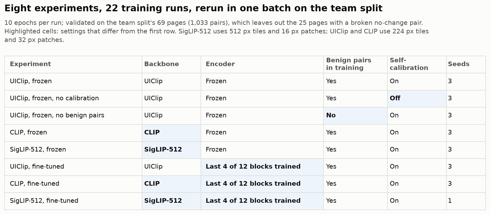

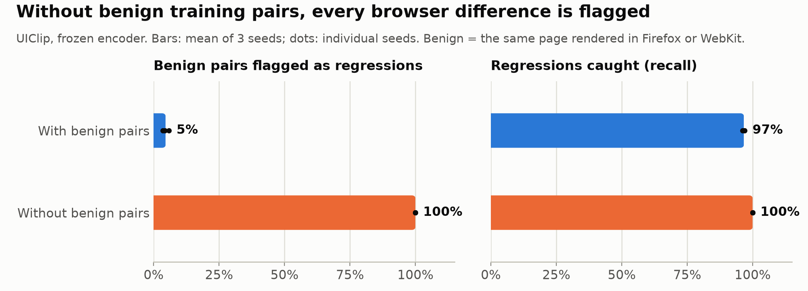

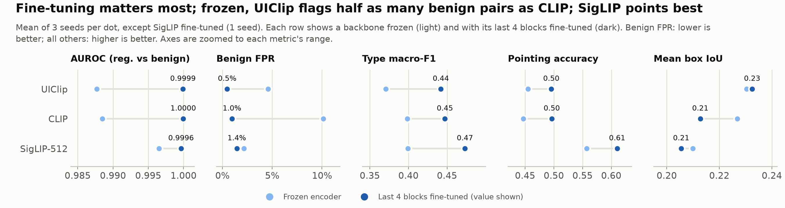

A slide version of the same comparison, 16:9 with a transparent background, is [`3b_backbones_frozen_vs_finetuned_slide.png`](../figures/uiclip/team_split/3b_backbones_frozen_vs_finetuned_slide.png).

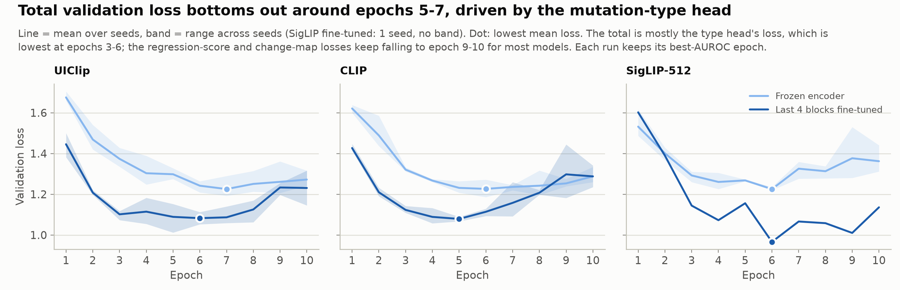

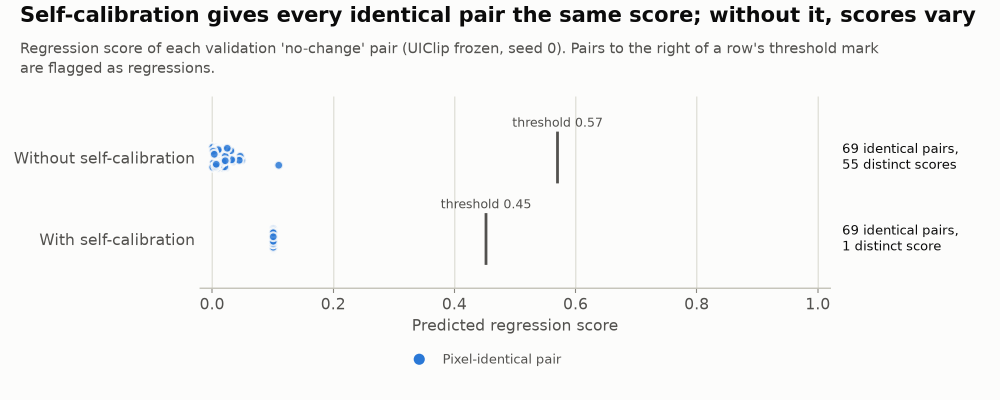

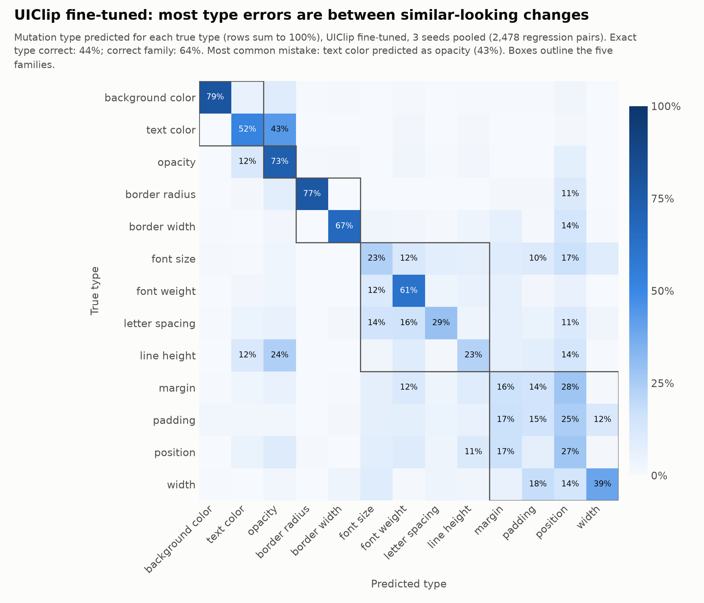

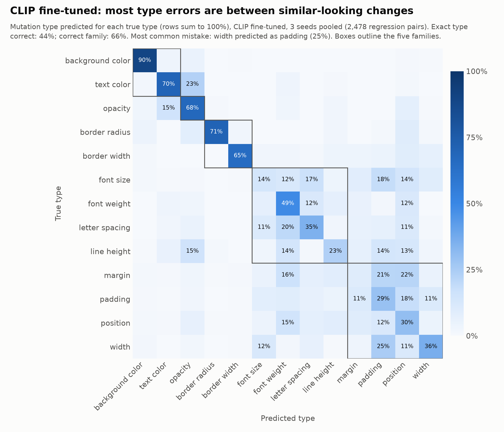

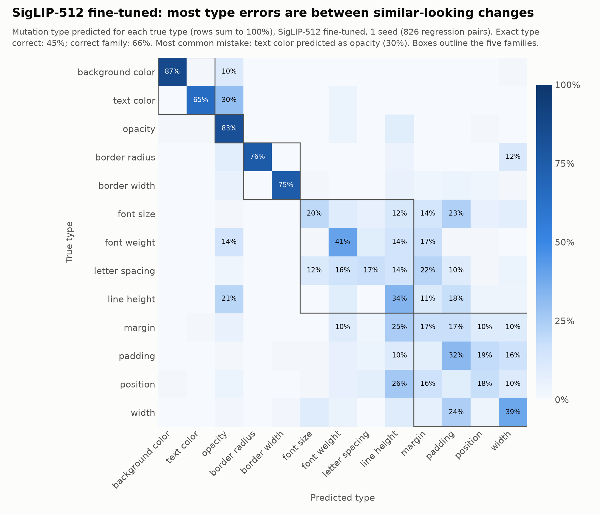

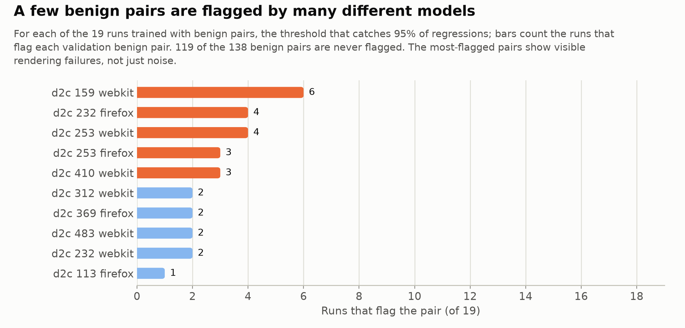

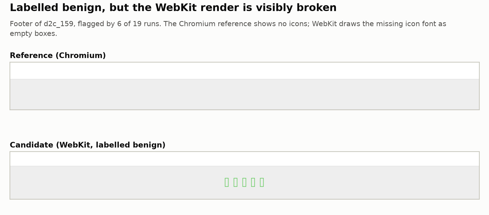

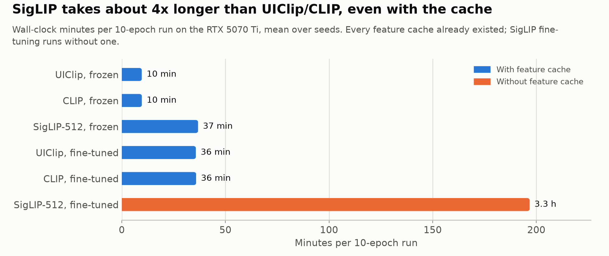
