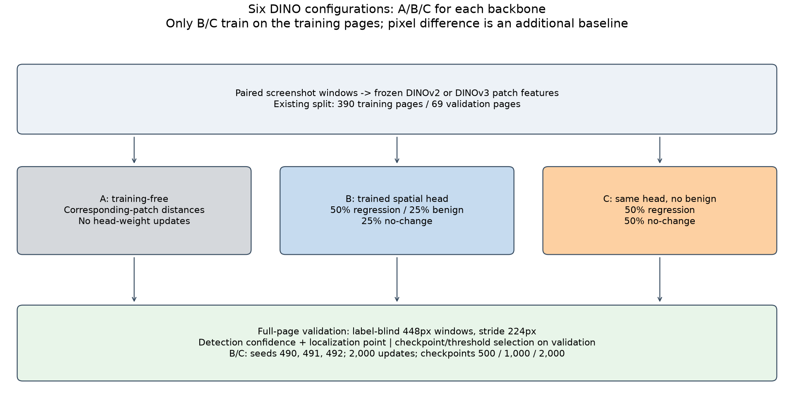
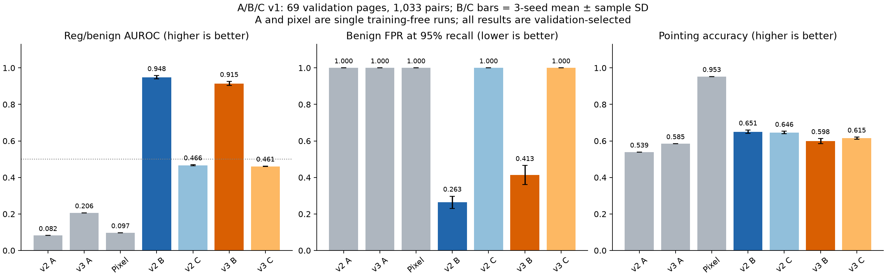
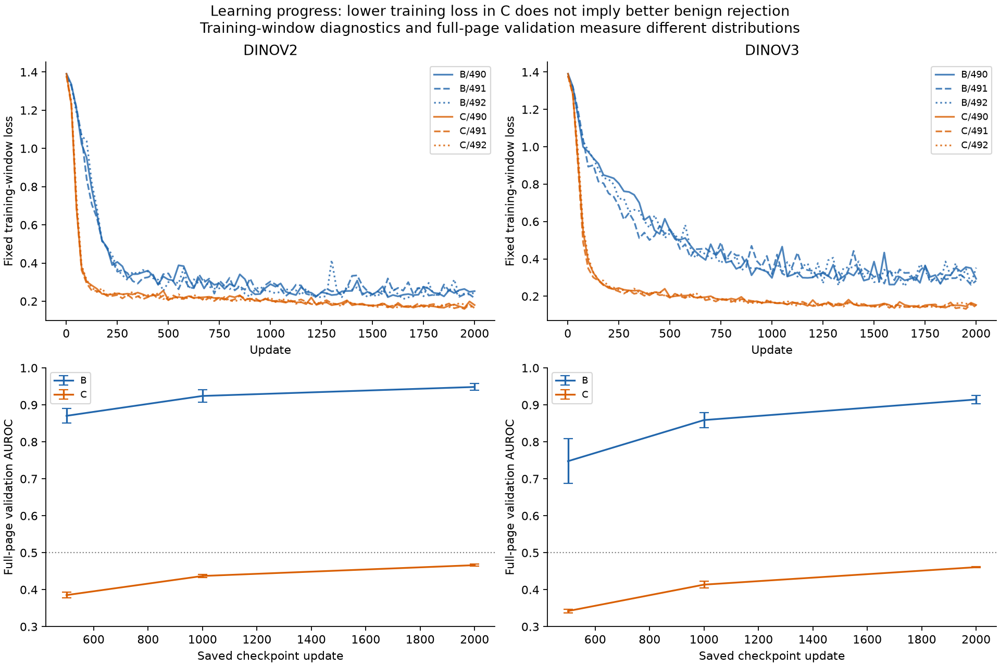
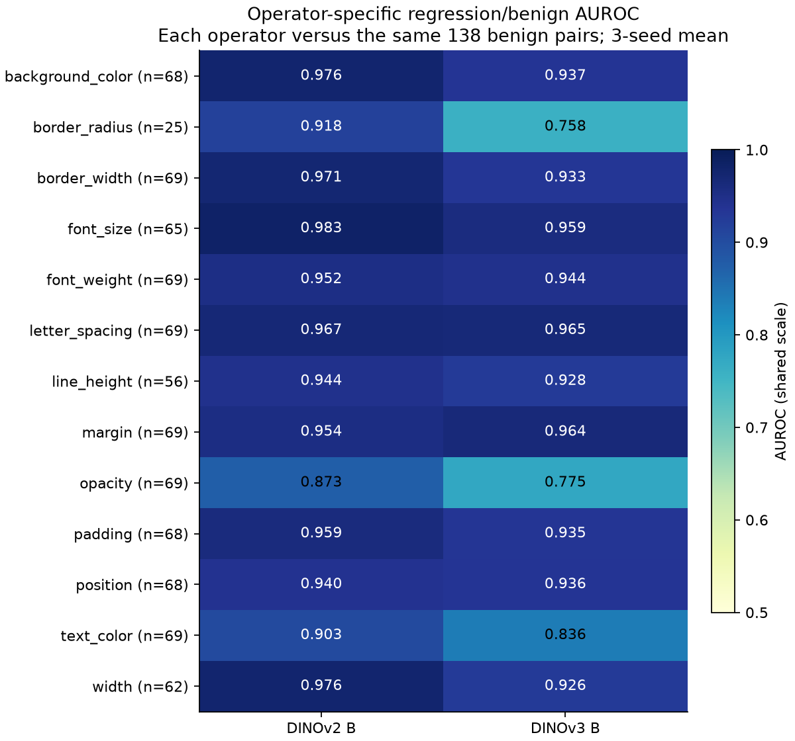
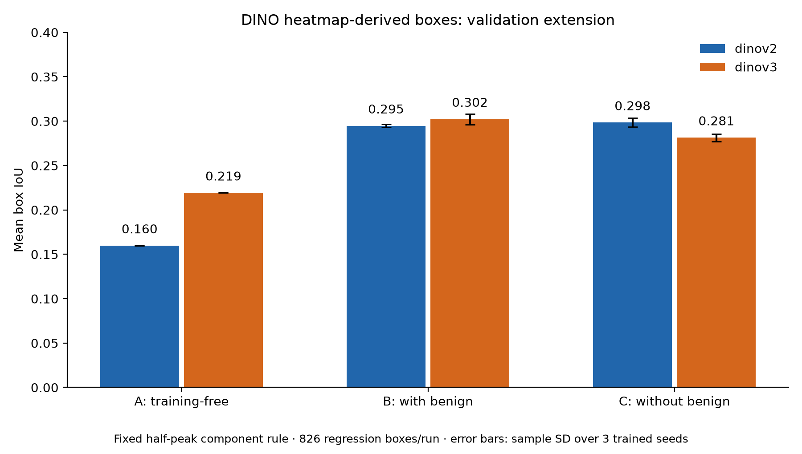

# DINO A/B/C: verified v1 validation comparison

Initially recorded 2026-11-14 from the lab comparison table, then verified against
the imported `outputs/lab-results/dino-results.tar.gz` bundle. The table retains
rounded values; detailed metrics and learning logs were inspected locally.
These are the original **v1 crop-manifest runs**, not corrected v2 runs.

This report and its four figures are committed to Git and render on GitHub.
Download [summary metrics (CSV)](metrics-v1.csv) or the
[curated metrics, learning records and provenance (JSON)](metrics-v1.json).
Datasets, webpage screenshots, checkpoint weights and full local run directories
remain ignored; these figures contain only aggregate measurements and diagrams.



## Completed comparison

All configurations use the committed 69 validation pages (1,033 pairs). B/C use
three seeds, 490/491/492, with validation-selected common checkpoint steps per
condition/backbone. AUROC variability is sample standard deviation across seeds.

| Backbone / baseline | Condition | Regression/benign AUROC | Seed SD | Benign FPR@95R | Pointing accuracy |
| --- | --- | ---: | ---: | ---: | ---: |
| DINOv2 | A: training-free distances | 0.0819 | — | 1.0000 | 0.5387 |
| DINOv3 | A: training-free distances | 0.2060 | — | 1.0000 | 0.5847 |
| Pixel difference | Pixel | 0.0970 | — | 1.0000 | 0.9528 |
| DINOv2 | B: with benign training | 0.9485 | 0.0092 | 0.2633 | 0.6505 |
| DINOv2 | C: without benign training | 0.4663 | 0.0027 | 1.0000 | 0.6457 |
| DINOv3 | B: with benign training | 0.9145 | 0.0110 | 0.4130 | 0.5985 |
| DINOv3 | C: without benign training | 0.4609 | 0.0013 | 1.0000 | 0.6146 |



For B/C, AUROC, FPR and pointing values are means over seeds. A/pixel values are
single training-free runs, not three-seed means. The supplied DINOv3 selection
log selects step 2,000 for both B and C. Inspection confirms that DINOv2 also
selects step 2,000 for both conditions.

<!-- shared-scorer:start -->

## Complete shared-scorer metrics

All seven configurations below use the same 1,033 validation pairs: 826 regressions, 138 benign pairs and 69 no-change pairs. B/C select update 2,000 and show **mean ± sample SD across seeds 490/491/492**; A/pixel are single runs. Counts are per run, not totals pooled over seeds. Scorer format is version 1; decision thresholds maximize F1 on validation.

| Metric | dinov2 A | dinov3 A | Pixel | dinov2 B | dinov2 C | dinov3 B | dinov3 C |
|---|---:|---:|---:|---:|---:|---:|---:|
| Pairs (n) | 1033 | 1033 | 1033 | 1033 | 1033 | 1033 | 1033 |
| AUROC: regression / benign | 0.0819 | 0.2060 | 0.0970 | 0.9485 ± 0.0092 | 0.4663 ± 0.0027 | 0.9145 ± 0.0110 | 0.4609 ± 0.0013 |
| AUROC: regression / all negatives | 0.3879 | 0.4707 | 0.3980 | 0.9656 ± 0.0061 | 0.6442 ± 0.0018 | 0.9425 ± 0.0071 | 0.6406 ± 0.0008 |
| Benign FPR at 95% recall | 1.0000 | 1.0000 | 1.0000 | 0.2633 ± 0.0342 | 1.0000 ± 0.0000 | 0.4130 ± 0.0523 | 1.0000 ± 0.0000 |
| 95%-recall operating threshold | 0.000603831664 | 0.000478347996 | 0.000320099731 | 0.873091002 ± 0.0292182621 | 0.999999324 ± 3.64190395e-07 | 0.645335257 ± 0.0416816195 | 0.99999694 ± 5.63361123e-07 |
| Achieved recall at that threshold | 0.9504 | 0.9504 | 0.9504 | 0.9504 ± 0.0000 | 0.9508 ± 0.0007 | 0.9504 ± 0.0000 | 0.9508 ± 0.0007 |
| Max-F1 decision threshold | 2.05358137e-05 | 2.45059855e-05 | 3.55615812e-05 | 0.794738452 ± 0.079626063 | 0.773996433 ± 0.102840709 | 0.552370608 ± 0.0823821289 | 0.753311733 ± 0.119656105 |
| Precision | 0.8568 | 0.8568 | 0.8568 | 0.9431 ± 0.0159 | 0.8568 ± 0.0000 | 0.9262 ± 0.0067 | 0.8568 ± 0.0000 |
| Recall | 1.0000 | 1.0000 | 1.0000 | 0.9713 ± 0.0131 | 1.0000 ± 0.0000 | 0.9661 ± 0.0079 | 1.0000 ± 0.0000 |
| F1 | 0.9229 | 0.9229 | 0.9229 | 0.9569 ± 0.0031 | 0.9229 ± 0.0000 | 0.9457 ± 0.0036 | 0.9229 ± 0.0000 |
| Accuracy | 0.8664 | 0.8664 | 0.8664 | 0.9300 ± 0.0057 | 0.8664 ± 0.0000 | 0.9113 ± 0.0058 | 0.8664 ± 0.0000 |
| Benign FPR at max-F1 threshold | 1.0000 | 1.0000 | 1.0000 | 0.3527 ± 0.1068 | 1.0000 ± 0.0000 | 0.4614 ± 0.0471 | 1.0000 ± 0.0000 |
| No-change FPR at max-F1 threshold | 0.0000 | 0.0000 | 0.0000 | 0.0000 ± 0.0000 | 0.0000 ± 0.0000 | 0.0000 ± 0.0000 | 0.0000 ± 0.0000 |
| Type macro-F1 | — | — | — | — | — | — | — |
| Pointing accuracy | 0.5387 | 0.5847 | 0.9528 | 0.6505 ± 0.0092 | 0.6457 ± 0.0070 | 0.5985 ± 0.0140 | 0.6146 ± 0.0062 |
| Mean box IoU | — | — | — | — | — | — | — |
| Regressions with point predictions | 826 | 826 | 826 | 826 | 826 | 826 | 826 |
| Regressions with box predictions | 0 | 0 | 0 | 0 | 0 | 0 | 0 |

Detection precision/recall/F1/accuracy and class-specific FPRs use each run's **max-F1 threshold**. FPR@95R uses its own threshold; ties can make achieved recall exceed 95%. Pointing is evaluated on regressions independently of either threshold. Dashes mean unavailable, not zero: these models do not predict mutation classes or boxes. AUROC includes both requested negative definitions; identity controls make the all-negative version easier.

**Threshold summaries are descriptive, not deployable thresholds.** Each seed has its own selected value; exact values are below and in `metrics-v1.json`. Extra significant digits prevent near-zero/near-one thresholds from appearing equal after rounding.

### Exact per-seed operating thresholds

| Model | Condition | Seed | Max-F1 threshold | 95%-recall threshold | Achieved recall at 95%-recall threshold |
|---|---|---:|---:|---:|---:|
| dinov2 | A | — | 2.0535813746391796e-05 | 0.0006038316641934216 | 0.950363 |
| dinov3 | A | — | 2.4505985493306071e-05 | 0.00047834799624979496 | 0.950363 |
| pixel | pixel | — | 3.5561581171350554e-05 | 0.00032009973074309528 | 0.950363 |
| dinov2 | B | 490 | 0.71537238359451294 | 0.83990633487701416 | 0.950363 |
| dinov2 | B | 491 | 0.79422098398208618 | 0.89495497941970825 | 0.950363 |
| dinov2 | B | 492 | 0.87462198734283447 | 0.88441169261932373 | 0.950363 |
| dinov2 | C | 490 | 0.82089889049530029 | 0.99999964237213135 | 0.951574 |
| dinov2 | C | 491 | 0.65606594085693359 | 0.99999892711639404 | 0.950363 |
| dinov2 | C | 492 | 0.8450244665145874 | 0.99999940395355225 | 0.950363 |
| dinov3 | B | 490 | 0.64462220668792725 | 0.69308513402938843 | 0.950363 |
| dinov3 | B | 491 | 0.48614388704299927 | 0.62668710947036743 | 0.950363 |
| dinov3 | B | 492 | 0.52634572982788086 | 0.61623352766036987 | 0.950363 |
| dinov3 | C | 490 | 0.83775413036346436 | 0.99999737739562988 | 0.951574 |
| dinov3 | C | 491 | 0.61638206243515015 | 0.99999713897705078 | 0.950363 |
| dinov3 | C | 492 | 0.80579900741577148 | 0.99999630451202393 | 0.950363 |

### Shared-scorer recall breakdowns

These are regression recalls at each run's max-F1 threshold. They are not operator AUROCs or localization scores. `reflow=True` means the mutation propagates layout changes; `False` denotes non-reflow examples.

| Metric | dinov2 A | dinov3 A | Pixel | dinov2 B | dinov2 C | dinov3 B | dinov3 C |
|---|---:|---:|---:|---:|---:|---:|---:|
| Recall: family / appearance | 1.0000 | 1.0000 | 1.0000 | 0.9082 ± 0.0365 | 1.0000 ± 0.0000 | 0.8696 ± 0.0383 | 1.0000 ± 0.0000 |
| Recall: family / colour | 1.0000 | 1.0000 | 1.0000 | 0.9416 ± 0.0219 | 1.0000 ± 0.0000 | 0.9440 ± 0.0152 | 1.0000 ± 0.0000 |
| Recall: family / layout | 1.0000 | 1.0000 | 1.0000 | 0.9750 ± 0.0151 | 1.0000 ± 0.0000 | 0.9813 ± 0.0075 | 1.0000 ± 0.0000 |
| Recall: family / shape | 1.0000 | 1.0000 | 1.0000 | 0.9894 ± 0.0106 | 1.0000 ± 0.0000 | 0.9397 ± 0.0061 | 1.0000 ± 0.0000 |
| Recall: family / typography | 1.0000 | 1.0000 | 1.0000 | 0.9936 ± 0.0045 | 1.0000 ± 0.0000 | 0.9974 ± 0.0022 | 1.0000 ± 0.0000 |
| Recall: magnitude / large | 1.0000 | 1.0000 | 1.0000 | 0.9841 ± 0.0158 | 1.0000 ± 0.0000 | 0.9727 ± 0.0090 | 1.0000 ± 0.0000 |
| Recall: magnitude / medium | 1.0000 | 1.0000 | 1.0000 | 0.9749 ± 0.0095 | 1.0000 ± 0.0000 | 0.9821 ± 0.0036 | 1.0000 ± 0.0000 |
| Recall: magnitude / small | 1.0000 | 1.0000 | 1.0000 | 0.9528 ± 0.0142 | 1.0000 ± 0.0000 | 0.9409 ± 0.0118 | 1.0000 ± 0.0000 |
| Recall: reflow / False | 1.0000 | 1.0000 | 1.0000 | 0.9704 ± 0.0136 | 1.0000 ± 0.0000 | 0.9639 ± 0.0085 | 1.0000 ± 0.0000 |
| Recall: reflow / True | 1.0000 | 1.0000 | 1.0000 | 0.9867 ± 0.0115 | 1.0000 ± 0.0000 | 1.0000 ± 0.0000 | 1.0000 ± 0.0000 |

[Download all shared-scorer metrics and breakdowns as CSV](shared-scorer-v1.csv).

<!-- shared-scorer:end -->

## Artifact and metric verification

- All 12 training completion records report 2,000 updates and checkpoints at
  500/1,000/2,000. Each learning log contains 81 finite diagnostic records from
  update 1 through 2,000. Recorded configurations match the fixed batch size,
  learning rate, weight decay, condition and seed.
- All training configurations contain the same v1 window manifest: 11,818
  windows on the exact 390 training pages. Manifest dataset/split hashes match
  local data and the committed split; window source IDs belong to training.
- Both evaluations cover the exact same 1,033 validation IDs and 18 heads each.
  All 36 prediction files pass shared format/coverage checks. Recomputing shared
  metrics from predictions at the saved thresholds reproduces all saved AUROC,
  detection/FPR, localization and recall-breakdown values within 1e-12.
- Recomputing the declared selection rule confirms step 2,000 for all four
  backbone/condition combinations. The bundle omits checkpoint tensors and raw
  map archives by design, so this audit does not independently inspect learned
  weights or rerun model inference.

The committed [metrics snapshot](metrics-v1.json) records dataset/split/manifest
fingerprints, model revisions, run-source hashes, learning records, runtime and
aggregate results. Regenerate the four figures and summary CSV without private
data, pretrained weights or the ignored results bundle:

```bash
python3 scripts/build_dino_report.py
```

This requires the existing NumPy/Matplotlib environment and does not run inference
or training. The generator is [build_dino_report.py](../../../scripts/build_dino_report.py).
The original metric-recomputation script and audit JSON remain local under
`outputs/lab-results/`; original reports and review PNGs are under
`outputs/lab-results/extracted-v1/outputs/dino_heads/`.

## Learning progress and operating points

| Condition | AUROC at 500 | AUROC at 1,000 | AUROC at 2,000 |
| --- | ---: | ---: | ---: |
| DINOv2 B | 0.8704 | 0.9242 | 0.9485 |
| DINOv2 C | 0.3853 | 0.4370 | 0.4663 |
| DINOv3 B | 0.7477 | 0.8589 | 0.9145 |
| DINOv3 C | 0.3421 | 0.4136 | 0.4609 |



Fixed-training losses decrease and all fixed-training diagnostic AUROCs end at
1.0, including C. That diagnostic excludes benign pairs and uses windows, so
it cannot establish benign rejection or full-page generalization. C's lower
training loss is not evidence of a better model; its task lacks hard negatives.
Learning plots show noisy batch losses and finite gradient spikes, not numerical
divergence in the logged samples.

There is no observed validation-AUROC downturn at the three saved checkpoints.
Both B models are still improving through the budget, particularly DINOv3.
This neither rules out overfitting nor establishes convergence/underfitting.
The backbone ranking is conditional on this fixed 2,000-update recipe. A longer
matched B-only comparison would be a new experiment, not a replacement for these
results; no urgent rerun is needed to complete the current core comparison.

| Selected condition | Mean recall at max-F1 threshold | Mean benign FPR at max-F1 threshold | Mean benign FPR@95R |
| --- | ---: | ---: | ---: |
| DINOv2 B | 97.13% | 35.27% | 26.33% |
| DINOv3 B | 96.61% | 46.14% | 41.30% |

The max-F1 operating point accepts more false alarms to catch more regressions
on this class mix. Do not confuse it with the separate 95%-recall operating
point. All selected heads have zero no-change FPR at their max-F1 threshold.

DINOv2 B per-seed AUROCs are 0.9517/0.9380/0.9556; DINOv3 B values are
0.9031/0.9153/0.9252 (seeds 490/491/492). The observed ordering holds across
these seeds, but they are not independent validation datasets.

## Error patterns worth retaining

Per-operator AUROC here means that operator's regressions versus all 138 benign
pairs, averaged over seeds at the selected checkpoint:



- DINOv2 B is strongest on font-size (0.9833), width (0.9756) and background-colour
  (0.9756), and weakest on opacity (0.8731) and text-colour (0.9031).
- DINOv3 B is weakest on border-radius (0.7583; only 25 regression examples),
  opacity (0.7750) and text-colour (0.8364). Letter-spacing and margin are stronger.
- At max-F1 thresholds, mean benign Firefox/WebKit FPRs are 31.40%/39.13% for
  DINOv2 B and 45.89%/46.38% for DINOv3 B. These browsers were represented during
  training, so this is not an unseen-browser transfer experiment.
- In the predeclared seed-490 examples, small-change pointing is 44.57% for both
  B models (175 regressions, changed-box area <=0.1% of reference image area),
  compared with about 75% for large changes (>1%). This is single-seed descriptive
  evidence and geometric box area, not precise changed-pixel area.

Inspected learning plots for both backbones and two review examples:
`d2c_481_webkit` is a confident DINOv2 B false positive with browser/layout text
variation; `d2c_054_border_radius` is a low-confidence DINOv3 B false negative
whose localization peak falls in the broad target region. These illustrate that
detection confidence and localization maps can disagree. Border/padding response
is a plausible failure mechanism in the figures, not a proven dataset-wide cause.

C also saturates scores: for seed 490, all 138 benign scores equal 1.0, as do
775/826 DINOv2 and 763/826 DINOv3 regression scores. Many tied maxima limit ranking
and support the interpretation that identity-only training learns an overconfident
change detector. Unsaturated logits were not exported; do not invent recovered
rankings or change the reported score definition retrospectively.

## Conditional source-page uncertainty check

A paired bootstrap resamples the 69 source pages, keeping each page's related
pairs together, with 2,000 replicates and seed 490. For each replicate it averages
AUROC across the existing three trained seeds. Approximate 95% percentile
intervals for AUROC differences are:

| Difference | Interval |
| --- | --- |
| DINOv2 B minus DINOv3 B | [0.0045, 0.0607] |
| DINOv2 B minus DINOv2 C | [0.4502, 0.5061] |
| DINOv3 B minus DINOv3 C | [0.4214, 0.4824] |

These are conditional on the selected checkpoints. Selection is not repeated
inside bootstrap samples, and the same validation set was already used for
selection. They describe sensitivity to validation-page composition; they do
not remove selection optimism or establish independent external generalization.

## Main finding: benign supervision changes detection substantially

B versus C is the most direct controlled comparison: same backbone/head recipe,
update budget, positive sampling stream and validation data; the negative mix
changes from no-change-only to benign plus no-change.

- DINOv2 AUROC rises from 0.4663 to 0.9485: an absolute increase of 0.4822.
- DINOv3 AUROC rises from 0.4609 to 0.9145: an absolute increase of 0.4536.
- At 95% regression recall, mean benign false-positive rate drops from 100% to
  26.33% for DINOv2 and 41.30% for DINOv3.

This supports the value of the implemented benign-supervision recipe on these
validation pages. A head trained only against identity controls does not learn
useful regression/benign ranking here. It does not prove that frozen DINO learns
a universal notion of harmlessness or intent.

B versus A shows an overall learned-pipeline improvement. It does not isolate
the head alone: A uses top-5% pooled raw distances, while B/C use learned window
classification with maximum-window aggregation. B versus C is the cleaner
ablation for the contribution of benign supervision.

## Leading configuration and unresolved localization

DINOv2+B leads this validation comparison: AUROC 0.9485 versus 0.9145 for
DINOv3+B, with lower benign FPR@95R (0.2633 versus 0.4130). The AUROC difference
is 0.0340. This is a validation ranking, not a statistical significance claim
or evidence of superiority on a new dataset.

The learned heads do not beat pixel pointing accuracy (0.9528). DINOv2+B reaches
0.6505 and DINOv3+B reaches 0.5985. Within a backbone, B versus C changes pointing
by only +0.0048 for DINOv2 and -0.0161 for DINOv3. Thus the clear gain from benign
supervision is detection/rejection, not a consistent localization improvement.

Pointing is scored on regressions independently of the detection threshold.
For non-reflow cases its target is pixel-difference-derived, which partly
explains the direct pixel baseline's geometric advantage. Large/partial weak
boxes, patch resolution, and localization-loss behavior require inspection;
this table alone does not establish why the heads miss a location.

## Limits and next analysis

- The same validation pages select checkpoints and decision thresholds. There
  is no independent internal-test result. Seed SD is training variability, not
  an uncertainty interval for new webpages; many pairs share a source page.
- A benign FPR of 26.33% at 95% recall is a meaningful improvement but still
  produces substantial nuisance alarms. AUROC alone does not establish an
  acceptable operating threshold. Inspect precision/recall and negative FPRs
  at each validation-selected threshold.
- Selecting the final saved step does not show that training has converged,
  nor prove underfitting. The inspected trends are described above.
- The v1 manifest omits positive coverage in two regression anchor crops out of
  4,739. Preserve and disclose this small limitation. The prepared correction
  changes those crops and one matched control; do not mix versions or discard
  these results solely for that omission.
- The imported bundle passes the record/prediction checks above. Checkpoint
  weights and raw maps remain on the lab machine; preserve them with the
  manifests before any cleanup. This report does not authorize another run.
- DiffSpot remains deferred. Do not claim external generalization or begin
  another tuning round merely to improve the reported validation comparison.

See [the student guide](../../dino-experiments-explained.md),
[the baseline protocol](fullpage-run.md), and [the training protocol](head-runs.md).

## Verified box-localization extension (2026-11-16)

The lab export completed all 14 selected A/B/C runs. Shared metrics were
recomputed locally from every augmented prediction file; all 1,033 IDs/run,
original score/point fields, detection metrics and pointing rates match.
Each run now has 826 regression boxes. These are post-processed heatmap boxes
under the fixed half-peak rule, separate from the original box-free reports.

| Model | Condition | Mean box IoU | Seed SD | Regression boxes/run |
|---|---|---:|---:|---:|
| dinov2 | A | 0.1596 | — | 826 |
| dinov2 | B | 0.2947 | 0.0017 | 826 |
| dinov2 | C | 0.2983 | 0.0050 | 826 |
| dinov3 | A | 0.2191 | — | 826 |
| dinov3 | B | 0.3022 | 0.0059 | 826 |
| dinov3 | C | 0.2813 | 0.0043 | 826 |



DINOv3 B has slightly higher box IoU (.3022) than DINOv2 B (.2947), despite
lower pointing and detection AUROC. These metrics assess different aspects:
IoU measures extent against diff_bbox; reflow pointing targets bbox_after.
C's similar localization does not rescue its poor benign rejection. Neither
head reliably recovers full change extent under this simple box rule.
This does not establish a statistically significant backbone difference.

The raw maps are absent locally: scoring, preserved predictions, source hashes
and aggregation were audited, but map-to-box extraction was not independently
rerun. No thresholds were selected for IoU. This remains post-hoc validation,
not independent evaluation. Mutation-type metrics remain unavailable.

[Aggregate CSV](box-metrics-v1.csv) · [Per-run metrics and audit](box-metrics-v1.json)
· [Procedure and lab commands](box-localization.md).
